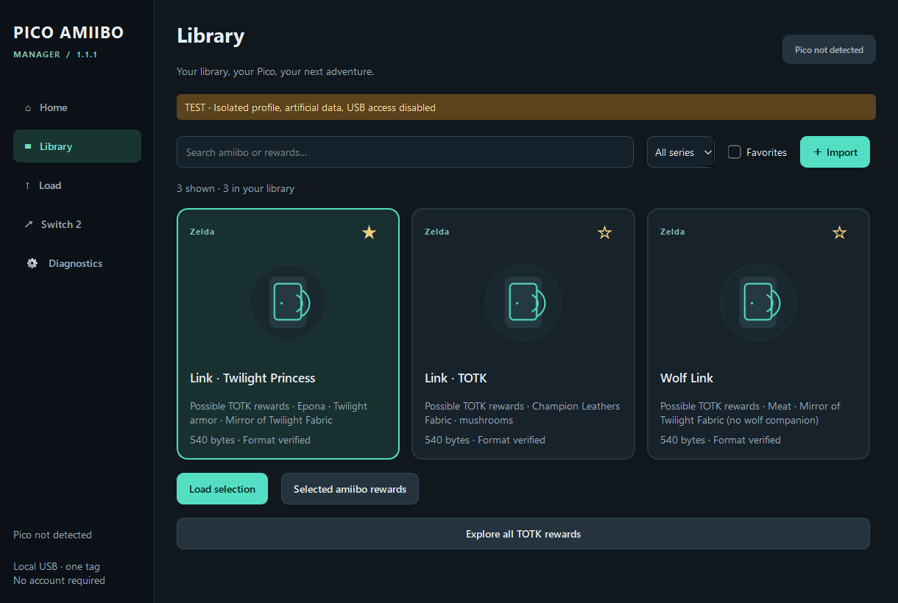

# PicoAmiibo-RP2040

**USB amiibo emulation for the original Raspberry Pi Pico, with a portable Windows Manager.**

PicoAmiibo turns a **non-wireless RP2040 Pico** into a USB Pro Controller 2
protocol emulator. Load one of your own amiibo files from a Windows PC, move the
Pico to your Nintendo Switch 2, and present the stored tag in a compatible game.
The Pico has no NFC radio: amiibo reads are emulated through the USB controller protocol.

The project includes firmware, a desktop application, a command-line loader, and
reproducible host tests. It does not modify the console, game, or save files.

## Current status

- **Real Switch 2 result:** the user reported obtaining **Epona in Tears of the
  Kingdom** after the firmware 0.1.1 delivery. This is a specific functional
  observation, not a claim that every game or amiibo has been qualified.
- **Windows Manager:** real CDC identification/readback was observed with 0.1.1.
  A 1.0.1 transfer is recorded as verified, with game recognition reported by the user.
- **Manager 1.1.1:** English interface, documentation, and reward catalog; tested
  through automated Qt tests and a real Windows EXE smoke test with USB disabled.
  This English build has not received a new end-to-end console qualification.
- **Firmware 0.1.2:** removes the BOOTSEL L+R gesture. It builds and passes host
  tests, but its real-console qualification is still pending.

Keep a working 0.1.1 installation when trying the Manager. Updating the desktop
application does not require flashing new firmware.

## Download

Get the Windows x64 portable ZIP from [Releases](https://github.com/LockingFR/PicoAmiibo-RP2040/releases).
Extract the **entire archive** and run **PicoAmiibo-Manager.exe**. Keep
`_internal` beside the executable; no system Python installation is required.

The release includes an empty library, application source, license notices,
checksums, and separately labeled recovery firmware when available.
It contains **no amiibo dumps, amiibo authentication keys, game files, or saves**.
Firmware UF2 files contain no preloaded amiibo data. Import your own files locally.

## Quick start

1. Connect a Pico with the compatible firmware to the PC using a **USB data cable**.
2. **After startup**, hold BOOTSEL for two seconds and release. The Pico switches
   to its USB CDC configuration port. Holding BOOTSEL before connecting instead
   opens the RPI-RP2 firmware recovery drive.
3. In **Library → Import**, choose a raw **540-byte or 572-byte** NTAG215 `.bin` file.
4. Select the correct Pico and amiibo, then click **Load and verify**.
5. Wait for **Saved and verified on the Pico**. The loader confirms the flash
   commit and compares every byte read back with the original input.
6. Open the **Switch 2 guide**, unplug the Pico from the PC, and connect it to the
   Switch 2 dock using the controller setup that works on your console.
7. Open the amiibo scan in TOTK and briefly tap BOOTSEL to present the tag.
   A second short tap removes it. If A is requested, quickly tap BOOTSEL twice
   on firmware 0.1.1/0.1.2, or use A on your regular controller.

A successful PC readback proves the stored bytes match the input; it does not
prove that the game accepted the tag. The PC cannot monitor the Pico while it
is attached to the Switch 2. Game feedback in the Manager is a user report.

For full instructions and recovery, see [Manager usage](MANAGER_USAGE.md) and
[physical firmware tests](USER_TEST.md).

## Windows Manager

- English dark interface with Home, Library, Load, Switch 2 guide, and Diagnostics.
- Persistent local library, SHA256 duplicate detection, favorites, and search.
- USB/COM discovery with explicit selection when multiple Pico devices are present.
- Real transfer/readback progress, cancellation, clear errors, and transfer history.
- Version-specific BOOTSEL instructions and a separate user-reported game result.
- Offline TOTK reward references: **36 profiles**, including 33 specific figures.
- **Diagnostics → Show TOTK rewards** controls reward summaries, reward search,
  and access to reward cards; the setting persists after restart.
- Optional public metadata/artwork downloads with a local cache. Private tag
  files are never uploaded. No Nintendo artwork is bundled.



Screenshots are from an isolated **TEST** profile with USB access disabled.

### TOTK rewards are possibilities

The catalog lists possible fabrics, armor, weapons, and materials, with progression
conditions and source links. It cannot select or guarantee loot.

For example, **Zelda – Super Smash Bros.** can yield the **Dusk Bow** after visiting
the Depths, but the bow is not guaranteed on every scan. **Epona** is a special
case for the relevant Link figures. Displayed table weights are not per-scan odds.
The catalog is a dated reference, not a record of items obtained on your console.

## Hardware and firmware

Target: **Raspberry Pi Pico, RP2040, `PICO_BOARD=pico`**, originally tested with
an RP2040 B2 board. No Pico W, Bluetooth, Wi-Fi, NFC antenna, or additional buttons
are required. A data-capable USB cable and a compatible Switch 2 USB connection
are required. The same USB port is used sequentially for PC and console.

Normal mode exposes `057E:2069` with HID and vendor bulk interfaces. Configuration
mode exposes `CAFE:4013` as CDC. The bootloader uses `2E8A:0003`. A retail Pro
Controller 2 can share the normal VID/PID, so that identity alone is not proof
that Windows has found a Pico.

Firmware 0.1.2 BOOTSEL gestures:

- Short tap: present/remove the tag after the double-tap detection delay.
- Two quick taps, less than 400 ms apart: send A for 180 ms, then release.
- Hold 600–1999 ms: no action.
- Hold two seconds: enter/leave CDC configuration.
- Hold while connecting power: ROM recovery bootloader.

On 0.1.1, an intermediate hold sends L+R. The Manager documents the difference;
L+R is not required by its normal guide. Optional GPIO 2/3/4/5 inputs for A/B/L/R
remain available. This is not a complete gameplay controller.

## Build the Windows app

Install Python 3.13 x64 and Git. From a clean checkout:

```powershell
powershell -NoProfile -ExecutionPolicy Bypass -File tools/build_manager.ps1
```

The script creates `.deps/manager-env`, installs pinned dependencies, builds a
Windows x64 executable, runs tests and an isolated EXE smoke test, then packages
the portable ZIP in `artifacts/manager-v1`. It never flashes hardware. Recovery
UF2 copies are optional when rebuilding from a fresh clone; see `firmware/README.md`.

For source development:

```powershell
python -m venv .deps/manager-env
./.deps/manager-env/Scripts/python.exe -m pip install -r manager/requirements.txt
./.deps/manager-env/Scripts/python.exe -m manager
```

## Build the firmware

The checked-in firmware source is **0.1.2**. Install an ARM GCC toolchain,
then run:

```powershell
powershell -NoProfile -ExecutionPolicy Bypass -File tools/setup.ps1
powershell -NoProfile -ExecutionPolicy Bypass -File tools/build.ps1 -BuildDirectory build/pico-p2
```

`tools/build.ps1` defaults to an existing devkitARM installation. Use
`-ArmToolchain /path/to/toolchain` to override it. The build enforces `PICO_BOARD=pico`.
Pinned dependencies include Pico SDK 2.2.0, CMake 3.31.6, and Ninja 1.12.1.
See [provenance](docs/PROVENANCE.md) for exact revisions.

The resulting `build/pico-p2/PicoAmiibo-RP2040-pico-empty.uf2` must be installed
manually on the correct RPI-RP2 drive. Do not replace working firmware merely to
update the Manager.

## Tests and evidence

```powershell
powershell -NoProfile -ExecutionPolicy Bypass -File tools/test_manager.ps1 -Frozen
powershell -NoProfile -ExecutionPolicy Bypass -File tools/test.ps1
```

Manager coverage includes invalid files, persistent library/preferences, duplicate
detection, wrong devices, partial I/O, disconnection, write refusal, corrupted
readback, cancellation, Qt interactions, and reward identities.

The firmware suite rebuilds **11 C executables** under WSL Ubuntu-24.04 with
ASan/UBSan and runs **13 Python tests**. It includes **5,120 simulated flash
interruptions** and **20,000 malformed USB packets**. The combined Manager/Python
suite currently contains **54 tests**. Host tests and simulated flash behavior
are separate from real Pico/Switch 2 evidence.

## Limitations

- One active tag on the Pico; multiple local library files are supported.
- Raw NTAG215 540/572-byte images only; format/BCC/CRC checks do not authenticate a tag.
- Console NFC writes are rejected; games requiring them may fail.
- The tag starts ejected. No radio NFC emulation or simultaneous PC/console connection.
- Firmware 0.1.2 and the English Manager still need their own hardware qualification.
- Long-running USB timing, repeated power loss, and broad game compatibility remain unqualified.

## Architecture, credits, and license

USB/NFC code is based specifically on **PicoSwitch2 `v2.5.0`**, commit
`cdb5bf6f85cef9998c11da280073a0c7642b712c`. Seven portable modules and their tests
retain their upstream hashes. USB command research is credited to
[ndeadly/switch2_controller_research](https://github.com/ndeadly/switch2_controller_research).

The Manager reuses `tools/load_amiibo.py` and the existing INFO/LOAD/READ/EXIT
protocol. Firmware uses two flash banks with generation, CRC, and a final commit
marker. See [architecture](MANAGER_ARCHITECTURE.md), [status](STATUS.md), and the
[independent technical review](MANAGER_REVIEW_CHATGPT.md).

Project code: **Apache-2.0**. Qt/PySide6: LGPLv3. Pico SDK, TinyUSB, Python,
pyserial, and the PyInstaller bootloader retain their own licenses.
See [LICENSE](LICENSE) and [third-party notices](THIRD_PARTY_NOTICES.md).
This is an independent project, not affiliated with Nintendo or Raspberry Pi.
